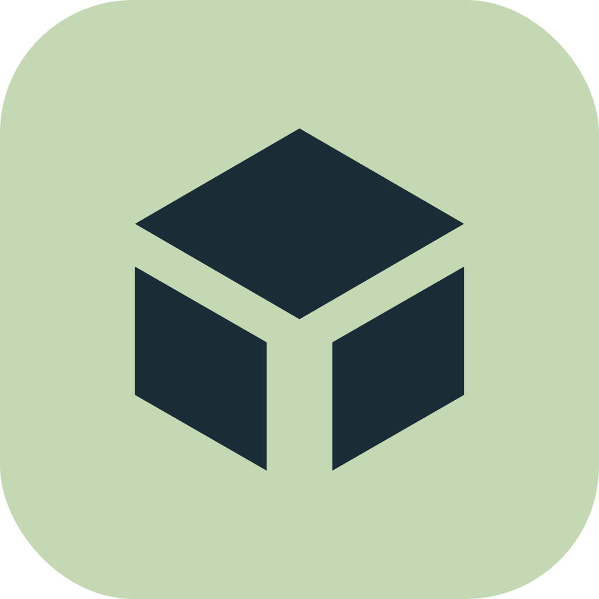

# Argo iOS

<p align="center">
  
</p>

Argo 的 iOS 手机伴侣：在 iPhone / iPad 上跟进编程会话、阅读进展、发送回复，采用 Persona 的相关界面、输入与配对体验。本仓库仅提供 iOS 客户端，Argo 主机需单独运行。

[English](README.md) · [构建与主机要求](ios/README.md) · [手机通知](docs/phone-notifications.md) · [iOS 源码候选](https://github.com/xiayuqin152/argo-ios/pull/3)

## 会话与输入

- 浏览已配对主机、工作区、消息、工具进展和会话历史。
- 已接通的 **managed 会话支持读写**，可正常回复和回答支持的问题；历史、manual 或未接入的会话保持只读。
- 手机发送的消息在主机读取到 Agent 会话记录后显示在对话中；**发送回执**另行显示发送中、排队、已投递或结果未知。
- 查看工作中、等待回复、完成和错误状态。发送后展示主机的投递/排队回执；结果未知时先刷新确认，再决定是否另发。
- 查看排队消息，打开或复制完整原文。早先的交接记录保持只读；隐藏记录不会撤回已交给 Agent 的输入。
- 展开输入框编辑长文本。Return 默认换行；在**设置 → 按回车发送**中开启后，Return 发送，Shift/Option-Return 换行。
- 附加照片或文件，并打开受管预览；主动点击系统 **Paste Image / 粘贴图片**按钮导入图片。

## 配对

在满足移动端契约的 Argo 主机执行：

```sh
argo pair
```

在 App 中扫描二维码、点击**粘贴配对码**，或手动输入完整的 `argo1:` 码。配对码有效期为 10 分钟，只能使用一次。扫码需相机权限和受支持设备；粘贴与手动输入持续可用。手机须能访问该主机，连接局域网时按提示允许本地网络访问。

主机需支持手机会话读取、消息回执和队列全文；手机提醒另需通知注册及主机的 APNs 配置。已核对的后端候选及具体能力见[主机兼容要求](ios/README.md#host-compatibility)，后端变更见 [Loom PR#44](https://github.com/xiayuqin152/loom/pull/44)。目前尚未指定已发布的最低主机版本。

## 手机提醒

配对后选择主机，在**设置 → 通知 → 在此 iPhone 接收 Agent 提醒**中开启。提醒正文仅包含状态；点击后打开对应的已配对主机和会话，不会发送消息。已停用或替换的注册所对应的旧提醒会被忽略。此功能需要正确签名的 App、iOS 通知权限及主机自己的 APNs 配置，详见[配置与权限说明](docs/phone-notifications.md)。

签名、真实 APNs 送达和设备后台收取仍待验收。前台会话由 App 读取，重新打开后恢复连接。

## 构建与安装

App 面向 iOS 26 及更新系统，使用 [ios/Argo.xcodeproj](ios/Argo.xcodeproj) 的 `Argo` scheme。[GitHub Actions](https://github.com/xiayuqin152/argo-ios/actions/workflows/ios-unsigned.yml) 使用所选 Xcode 执行 Core 测试、生成 Release iPhoneOS archive 和 unsigned IPA，随后在可用 iOS Simulator 上执行原生 UIKit 输入测试，保留归档和 UIKit 测试各自的 xcresult。本机没有完整 Xcode 时，可使用这条云构建路线；进入成功运行可查看对应提交、产物和日志。

工作流产生的 **unsigned IPA 不能直接安装**。真机安装需要 Apple Developer 账号、适用证书和描述文件；当前未配置已签名 IPA、TestFlight 或 App Store 渠道。构建入口和验收状态见[构建说明](ios/README.md)。

## 来源与许可

Argo 新增部分采用根目录 [MIT License](LICENSE)，© 2026 Argo contributors。

相关界面、输入和配对组件改写自 [Persona](https://github.com/nwverse/persona)，© 2026 nwverse，保留其 [MIT License](ios/ThirdParty/Persona/LICENSE)。[BeautifulUI](ios/ThirdParty/BeautifulUI)，© 2026 ChrisPan，保留 [MIT License](ios/ThirdParty/BeautifulUI/LICENSE)；基础设计来自 [Beautiful UI](https://www.beautifului.dev/)，© 2026 Shane Levine，原版 [MIT 许可](ios/ThirdParty/BeautifulUI/LICENSE-beautifului)和 [NOTICE](ios/ThirdParty/BeautifulUI/NOTICE)均保留。逐文件来源见 [UPSTREAM.md](UPSTREAM.md)。

Logo 与 AppIcon 沿用所有者既有的 Argo 品牌，原图和重建方式继续见[品牌来源](docs/branding/SOURCES.md)。
